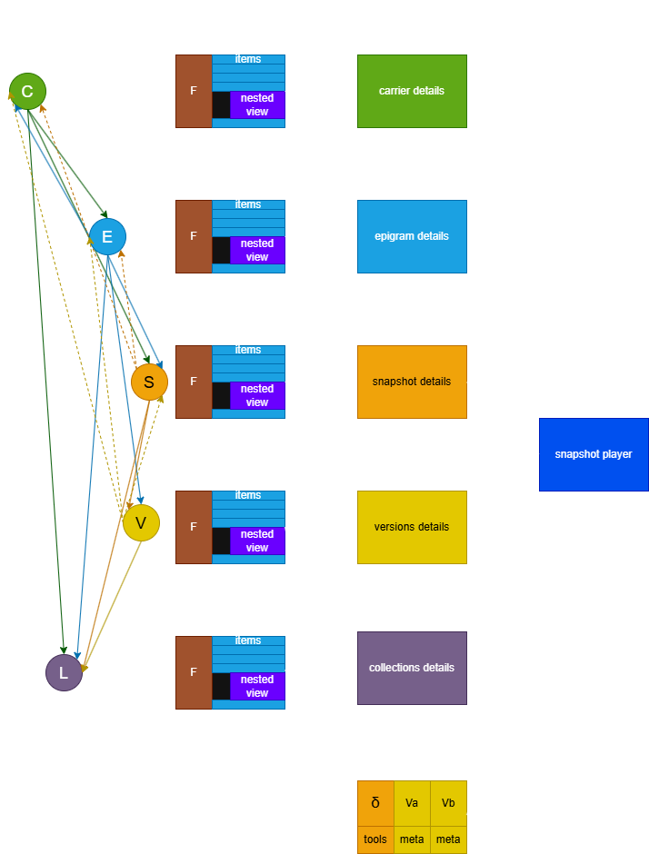
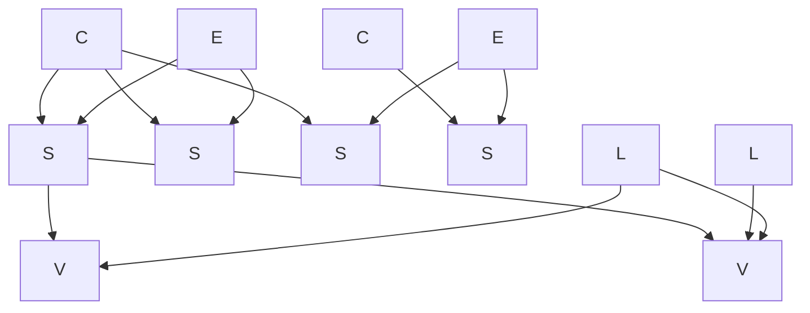
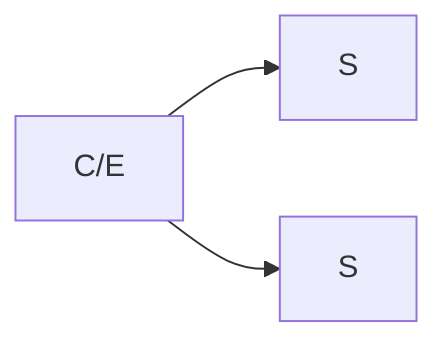
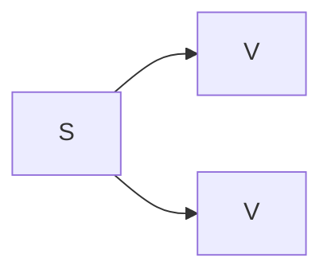
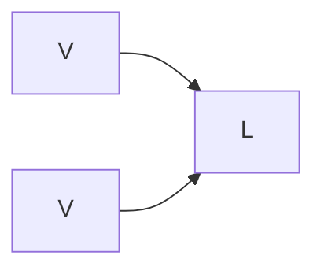

# Presentation

Presentation here is discussed at a higher level of abstraction: we focus more on _functional areas_ and _data views_ than on graphical mockups. Also, this does not cover all the possible views, nor any of the static pages which should be included in the real site. The focus here is on _data_ and their _relationships_, to emphasize a presentational model which does not flatten nor lose the complex graph of entities which was so carefully designed and implemented in the corresponding backend.

The idea is allowing easy and natural transitions across all the entities in the database: carriers (=the material support like notebooks), epigrams, text versions and collections, starting from any of them and walking seamlessly to the others. When inspecting text, you can look at the animated transformations using the already implemented component (the same used in the editor to preview the snapshot) and by comparing any number of text versions from the same epigram side by side, with real-time interactive diffing and more tools.

So, this presentation proposal focuses on two main areas:

- browsing a top-level overview of all the **entities** with their relationships (carriers, epigrams, snapshots, versions, collections): the entities graph.
- inspecting **texts** and their differences and live reconstruction: the text versions (generated from snapshots) and their snapshots.

In very generic terms, you could imagine a user experience like this:

- the user lands on the site home, where he can choose to browse data in various ways:
  - (_codicological path_): by looking at notebooks and other carriers: he will start with a [carriers view](# carriers-view) with the list of all carriers.
  - (_literary path_): by looking at the list of [epigrams](# epigrams-view).
  - (_textual path_): by looking directly at the list of text [versions](# versions-view) of epigrams. We can also have a full text search page, landing on this view as the results of the query.
  - (_publishing path_): by looking at the list of [collections](# collections-view), which variously group text versions in selected sequences.
- from any of these views, the user can walk seamlessly to view other entities, as explained in the description of each of them and summarized by the links in Figure 1.

Figure 1 shows a top-level overview of the navigation among the main views and summarizes the site's map, from left to right:

- in the _leftmost column_, the circled entity symbols represent entities as nodes of a graph; their links represent the direct navigational connections to other entities (via a nested view when the relationship is 1 to many; via a direct link to the entity when the relationship is 1 to 1; in the latter case, the line is dotted). This clearly shows the graph-shaped links among our entities, and allows users to naturally follow them in the direction they desire.
- the _mid column_ represent top-level views: users may want to see the lists of carriers, epigrams, versions, or collections. The list of snapshots is available only as a nested list because the snapshot is an intermediate model which can be easily hidden to avoid complicating the UI with it.
- the _righmost column_ contains secondary views: the details page for each single carrier, epigram, snapshot, version, or collection; plus the snapshot player (which "plays" the transformation of a text across its alteration stages) and the parallel view (which displays side by side a user-defined selection of text versions from the same epigram).



- _Figure 1 - Top-level views_

> Note that any of these views has a full set of filters which allow to perform searches among the items they list by combining a lot of criteria. Also, most of them allow drilling down into children views with other lists, thus effectively implementing a cross-entities walk along the entities graph.

For instance, say a user wants to see the texts for epigram 10:

1. he lands on the home page.
2. he picks the list of [epigrams](# epigrams-view) and browses to 10, or filters the list as desired to find it quickly.
3. he clicks the button in its row to drill down into its [text versions](# versions-view). Text versions are listed below epigram 10 with their text and metadata.
4. if he wants to compare versions inspecting their details, he freely selects all the versions from the list by clicking their select button; when done, he clicks a button which leads him to the parallel view.
5. the [parallel view](# parallel-view) shows all the selected text versions side by side as columns, with their metadata and an interactive diffing environment.

This is just an example; but any of the paths along the lines connecting the views in Figure 1 can be followed, at any time, with a rich set of filters for immediate search and highly interactive views on text.

## (1) Entities Graph

An essential aspect of the model devised for VEdition is that it reflects the **"constellation"** of texts which goes under the name of "Venetian epigrams", where there is no plain linear evolution. Many versions of the "same" text (the abstraction we name "epigram", here `E`) coexist, scattered across multiple manuscripts or prints (the "text carriers", `C`), variously grouped under multiple collections (material or immaterial; `L`).

Each of these documents (named "snapshots", `S`) mostly contains multiple "versions" of the text (`V`), as its manuscript annotations hint at various transformations of the text first jotted down on paper. So, these versions are not written at length, but they are the result of interpreting the annotations on the base text which hint at them. Such documents represent a "snapshot" of the creative process behind the transformations of a text, generating its multiple versions.

So, among these entities:

- `C` (carriers) contain `S` (snapshots);
- `E` (epigrams) contain `S` (snapshots);
- `S` (snapshots) contain (they actually generate) `V` (versions);
- `L` (collections) contain (they actually collect) `V` (versions);
- `V` (versions) are the only entities representing text.

> Among these entities, `C` is material; `S` is an abstraction but in a sense it is partially material, because it is based on a unitary set of signs on paper; `E` is an abstraction; `V` is (mostly) a reconstruction; and `L` can be either an abstraction (the collection resulting from numbering some versions) or a material entity (e.g. the carrier collecting snapshots in a given order).

The result is a **graph** of nodes (=entities) which can be browsed starting from any node and following the links to any other node.

The diagram in Figure 2 exemplifies this graph:



- _Figure 2 - Top-level entities links_

In presenting these data we should try to reflect this complex set of relationships among different entities, allowing users to seamlessly hop from node to node and get a sense of their connection in the constellation.

If we consider the hierarchy intrinsic in the above defined entities, we can define 3 levels:

1. `C` and `E`
2. `S` and `L`
3. `V`

Here each upper level contains some or all entities of the lower level (Figures 3-5):



- _Figure 3: carriers and epigrams contain snapshots_

---



- _Figure 4: snapshots contain (generate) versions_

---



- _Figure 5: versions are grouped into collections_

---

## Presenting the Graph

In a presentation we should clearly present entities, while still allowing users to walk across their whole graph.

The 3 levels identified in the previous section allow us to define at least these **views** for our data; views act as reusable UI components and focus on a specific entity type:

1. **carriers view**: the list of all the material supports which carry our texts. Readers interested in codicological aspects or studying the story of a single material object would look into that.
2. **epigrams view**: the list of all epigrams. This is a virtual collection of all the abstractions representing a unitary group of text versions. Most readers will probably start from this list.
3. **snapshots view**: this would be probably best served as an intermediate view in walking the graph. The snapshot concept is an abstraction and is backed up by the [genetic model](architecture.md) defined for Hydra. Yet, the snapshot also has a material part: it is the sum of all signs we group together (base text and its annotations) on a portion of a sheet or on one or more sheets of a carrier, and it implicitly contains all the text versions. So, when flipping the pages of a notebook, we see snapshots; and when drilling down from an epigram node we find snapshots (which in turn contain versions).
4. **versions view**: the list of text versions. These are the only entities with text, so in the end readers will look for them. Anyway, the might want to get at this list in different ways: starting from an upper layer, e.g. when drilling down from an epigram through snapshots; or even by freely browsing all available texts, even when belonging to different epigrams (e.g. when landing to the list from a full-text search).
5. **collections view**: the list of all collections. These are material or immaterial groupings of text versions.

We can thus identify UI blocks which show entities in a compact, table-like layout, while still allowing to walk seamlessly from node to node.

### 👀 Carriers View

A paged list of all carriers matching carrier filters:

- a **filters panel** allow to combine various filters to view only the carriers matching them (e.g. name, date range, consistency, specific epigrams included, etc.). The filters start blank, so that the whole list is initially shown.
- each **list item** shows essential metadata about the [carrier](editor#carrier-item) plus:
  - a 🖼️ **view button** to directly view the list of carrier's facsimiles from IIIF. As usual here, we start with a list of thumbnails with labels and then let users pick any of them to see the facsimile in an interactive viewer, like in Mirador.
  - **navigation buttons** to walk from it:
    - ▶️ `E` epigrams: opens an _epigrams view_ filtered to show only the epigrams in that carrier;
    - ▶️ `S` snapshots: opens a _snapshots view_ filtered to show only the snapshots in that carrier;
    - ▶️ `L` collections: opens a _collections view_ filtered to show only the collections including snapshots from that carrier.

So readers will open a plain list of carriers; if desired, from each carrier in the list they can drill down to epigrams, snapshots and collections. This merges a table layout with a tree layout where each node is yet another view, e.g.:

```txt
+-----------+-------+------+-----------+-----------+------+-------+-----+
| filters   | E S L | name | shelfmark | materials | size | dates | ... |
|           |[E]S L | name | shelfmark | materials | size | dates | ... |  <== drilling down to epigrams for this carrier
|           +-|---------------------------------------------------------+
|           | Epigrams of H50                                           |  <== nested epigrams view
|           | ... compact epigrams view filtered by H50 ...             |
|           +-----------------------------------------------------------+
+-----------+-------+------+-----------+-----------+------+-------+-----+
```

> As for the real layout, one can define a more compact style for nested views and hide a portion or all of their filters (e.g. when viewing the epigrams from carrier H50, at least the carrier filter will be hidden). The nested view provides a quick insight and can be expanded or collapsed. Alternatively one can use a variant of the action linked to the button which opens a new page with that view as the root. This allows for the best of both worlds: having a top-level list of the entities you are interested in but still being able to quickly drill down to other related entities at a glance. From there you will be able to move to another page where the top level view is different, or just continue drilling down if possible.

The same type of layout applies to all other entities. This makes the UI modular, because the essential presentation strategy is the same for all. Note anyway that here we are defining the top level navigation experience to browse all the entities defined in the database following their internal connections. We will then add views for single entities, each specialized on its own, especially for viewing text.

### 👀 Epigrams View

A paged list of all epigrams matching epigram filters:

- a **filters panel** allow to combine various filters to view only the epigrams matching them (e.g. name, date range, hands, etc.). The filters start blank, so that the whole list is initially shown.
- each **list item** shows essential metadata about the [epigram](editor#epigram-item) plus:
  - **navigation buttons** to walk from it:
    - ▶️ `C` carriers: opens a _carriers view_ filtered to show only the carriers including that epigram.
    - ▶️ `S` snapshots: opens a _snapshots view_ filtered to show only the snapshots included in that epigram.
    - ▶️ `V` versions: opena a _versions view_ filtered to show only the versions of that epigram. This bypasses the intermediate snapshot level to go straight to texts when we focus on text content rather than on its materiality.
    - ▶️ `L` collections: opens a _collections view_ filtered to show only the collections including that epigram.

### 👀 Snapshots View

A paged list of all snapshots matching snapshot filters:

- a **filters panel** allow to combine various filters to view only the snapshots matching them (e.g. epigram, carrier, hands, etc.). The filters start blank, so that the whole list is initially shown.
- each **list item** shows essential metadata about the [snapshot](editor#snapshot-item) plus:
  - 🔗 `C` **carrier name** as a link: a snapshot always has 1 parent carrier. Click it to open it.
  - 🔗 `E` **epigram name** as a link: a snapshot always has 1 parent epigram. Click it to open it.
  - **navigation buttons** to walk from it:
    - ▶️ `V` versions: opena a _versions view_ filtered to show only the versions of that epigram. This bypasses the intermediate snapshot level to go straight to texts when we focus on text content rather than on its materiality.
    - ▶️ `L` collections: opens a _collections view_ filtered to show only the collections including that epigram.

### 👀 Versions View

A paged list of all versions matching version filters:

- a **filters panel** allow to combine various filters to view only the versions matching them (e.g. text, snapshot, epigram, etc.). The filters start blank, so that the whole list is initially shown.
- each **list item** shows essential metadata about the version plus:
  - 🔗 `C` **carrier name** as a link: a version always has 1 parent carrier. Click it to open it.
  - 🔗 `E` **epigram name** as a link: a version always has 1 parent epigram. Click it to open it.
  - 🔗 `S` **snapshot name** as a link: a version always has 1 parent snapshot. Click it to open it.
  - **navigation buttons** to walk from it:
    - ▶️ `L` collections: opens a _collections view_ filtered to show only the collections including that version.
  - **text**: an expandable small-font scrollable text frame with the version's text.
  - **selection button**: whether the version is selected for [parallel view](# parallel-view). Only versions belonging to the same epigram can be selected.

Selecting a text for parallel view adds it to the texts to be visually displayed side by side with a diffing report and their metadata (see [Texts](#2-texts)). This is very flexible because it allows you to compare any of the versions from the same epigram, even from different snapshots.

### 👀 Collections View

A paged list of all collections matching version filters:

- a **filters panel** allow to combine various filters to view only the collections matching them (e.g. virtual, carrier, epigram, etc.). The filters start blank, so that the whole list is initially shown.
- each **list item** shows essential metadata about the [collection](editor#collection-item) plus:
  - **navigation buttons** to walk from it:
    - `V` versions: opena a _versions view_ filtered to show only the versions of that collection (i.e. the contents of the collection).

## (2) Texts

From a pragmatic standpoint, the text view can be "animated" or "still":

- the **animated** view refers to the snapshot view experience, as already implemented within the editor when previewing the edited snapshot. Users will be able to see the live, animated transformation of the snapshot text stage after stage, manually step forward or backward, hover on text to see metadata, etc. So here the UI will just wrap the already existing component. You can get to this UI from any view which directly or indirectly displays a snapshot.
- the **still** view refers to a more analytic view experience, similar to that proposed by an early video mockup. This starts from the versions view, whether it is the top-level view, or is nested inside another view (see above). Having a list of filtered views allows users to freely select ANY of them (as far as they belong to the same epigram) to be part of the static view, where they are all displayed side by side: this is the **parallel view**.

### 👀 Parallel View

The parallel view is a set of any number of columns which mimick the more traditional visualization in other digital genetic editions with enhanced interactivity.

Starting from the **versions view**, users select any number of versions they want to see in this view. There is no technical limit; but practically we will impose an arbitrary maximum number of allowed versions in the view (e.g. 10), to avoid over-populating it and ensure a responsive UI even in low-performance clients.

Each **column** in the parallel view contains:

- the **full text** of the version.
- a **selection of metadata** for that version in a smaller collapsible panel below the text.

There is 1 column per selected version, plus a **diff column** in fixed position (we can anchor it at the left or right edge). A horizontal scrollbar allows to see all the columns when they are too many to fit within the browser window.

The diff column is an interactive, real-time computed view which shows the diffing between any of the selected columns in the parallel view. By default it starts by comparing the first two selected versions; but then users are free to compare any version with any other among those selected. So, if I choose two versions A and B, the diffing shows the differences between A and B: what was added and what was removed. This is similar to what is done inside the animated snapshot viewer: there, you can see the diffing between any two alteration stages in the snapshot.

This provides the following benefits:

- the view is focused on a single epigram (within or outside the boundaries of a single snapshot), but seamlessly integrated in the upper-level entities graph browsing experience. Users start by browsing carriers, epigrams, snapshots, collections, or versions, as they prefer, and reach any top-level or nested versions view from them; then, they frelly pick the versions they want to compare, and click a button to open the parallel view. When done, they go back to the list and possibly change their selection or continue browsing for other entities.
- users are completely free to decide which versions they want to compare, whether they come from the same or different snapshots, in the order they prefer.
- users are not limited to a predefined number of versions: rather than just the 2 canonical columns A and B, users can see any number of columns side by side to compare 2, 3, 4, or whatever other number of versions they want.
- users can interactively focus on any pair of versions among those displayed and see their computed diffing in the diff column. So, if they have selected versions A, B, C, D, E (in this order) the parallel view will open with the diff between A and B; but then at any moment users can pick another version for any of the two terms of the diffing pair (A:C, B:E, E:B, etc. -- any combination is possible).
- the visualization can fit any screen size and layout maximizing the usage of available space.

The view core would thus appear as in Figure 6 (let us assume we placed the diff view at the left -- this can also be a user-defined parameter, according to his preferences):

```txt
the diff column where user
selected v3 from snapshot
H5_001 and v12 from snapshot
A1_002

+------------------------+ +------------------------+ +------------------------+
| H5_001.v3 : A1_002.v12 | | H5_001.v3              | | A1_002.v12             |  ... etc.: as many versions as you want
+------------------------+ +------------------------+ +------------------------+  as far as they belong to the same epi-
| The diffed text        | | The version text here  | | The version text here  |  gram.
| is displayed           | |                        | |                        |
| here. Deletions in red | |                        | |                        |
| with strikethrough;    | |                        | |                        |
| additions in blue; the | |                        | |                        |
| rest in black.         | |                        | |                        |
+------------------------+ +------------------------+ +------------------------+
| [H5_001.v3  [↓]]       | | version metadata here  | | version metadata here  |
| [A1_002.v12 [↓]]       | |                        | |                        |
+------------------------+ +------------------------+ +------------------------+

in the low panel users
pick the versions to
include in the diffing
pair
```

- _Figure 6 - The parallel view_

We might then add a top toolbar with various commands to e.g. copy a version, download an XML file representing it, download the diffing, remove a version from the view, reorder versions in it, control zoom levels, etc.
