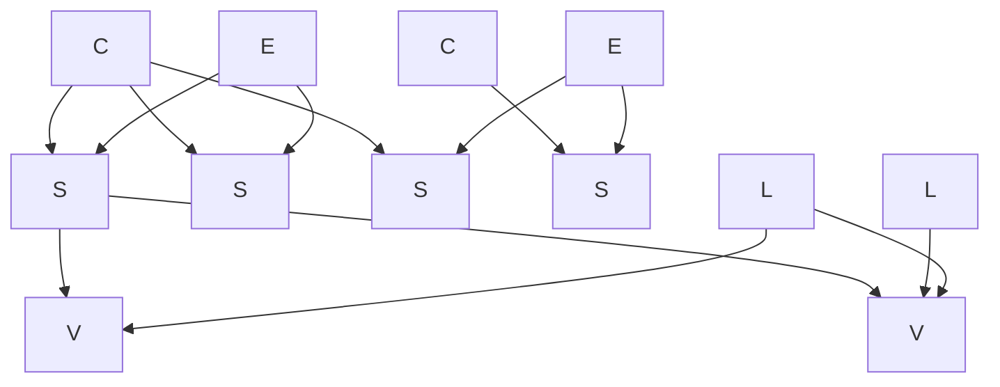
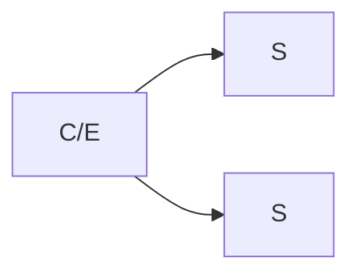
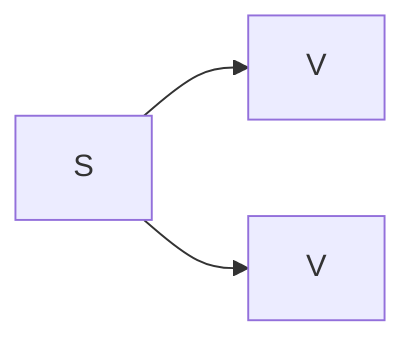
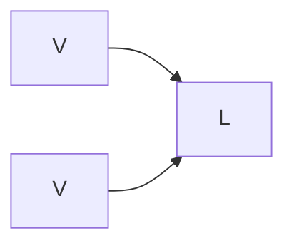

# Presentation

## Entities Graph

An essential aspect of the model devised for VEdition is that it reflects the **"constellation"** of texts which goes under the name of "Venetian epigrams", where there is no plain linear evolution. Many versions of the "same" text (the abstraction we name "epigram", here `E`) coexist, scattered across multiple manuscripts or prints (the "text carriers", `C`), variously grouped under multiple collections (material or immaterial; `L`).

Each of these documents (named "snapshots", `S`) mostly contains multiple "versions" of the text (`V`), as its manuscript annotations hint at various transformations of the text first jotted down on paper. So, these versions are not written at length, but they are the result of interpreting the annotations on the base text which hint at them. Such documents represent a "snapshot" of the creative process behind the transformations of a text, generating its multiple versions.

So, among these entities:

- `C` (carriers) contain `S` (snapshots);
- `E` (epigrams) contain `S` (snapshots);
- `S` (snapshots) contain (they actually generate) `V` (versions);
- `L` (collections) contain (they actually collect) `V` (versions);
- `V` (versions) are the only entities representing text.

> Among these entities, `C` is material; `S` is an abstraction but in a sense it is partially material, because it is based on a unitary set of signs on paper; `E` is an abstraction; `V` is (mostly) a reconstruction; and `L` can be either an abstraction (the collection resulting from numbering some versions) or a material entity (e.g. the carrier collecting snapshots in a given order).

The result is a **graph** of nodes (=entities) which can be browsed starting from any node and following the links to any other node.

The diagram in Figure 1 exemplifies this graph:



- _Figure 1 - Top-level entities links_

In presenting these data we should try to reflect this complex set of relationships among different entities, allowing users to seamlessly hop from node to node and get a sense of their connection in the constellation.

If we consider the hierarchy intrinsic in the above defined entities, we can define 3 levels:

1. `C` and `E`
2. `S` and `L`
3. `V`

Here each upper level contains some or all entities of the lower level (Figures 2-4):



- _Figure 2: carriers and epigrams contain snapshots_

---



- _Figure 3: snapshots contain (generate) versions_

---



- _Figure 4: versions are grouped into collections_

---

## Presenting the Graph

In a presentation we should clearly present entities, while still allowing users to walk across their whole graph.

The 3 levels identified in the previous section allow us to define at least these **views** for our data; views act as reusable UI components and focus on a specific entity type:

1. **carriers view**: the list of all the material supports which carry our texts. Readers interested in codicological aspects or studying the story of a single material object would look into that.
2. **epigrams view**: the list of all epigrams. This is a virtual collection of all the abstractions representing a unitary group of text versions. Most readers will probably start from this list.
3. **snapshots view**: this would be probably best served as an intermediate view in walking the graph. The snapshot concept is an abstraction and is backed up by the [genetic model](architecture.md) defined for Hydra. Yet, the snapshot also has a material part: it is the sum of all signs we group together (base text and its annotations) on a portion of a sheet or on one or more sheets of a carrier, and it implicitly contains all the text versions. So, when flipping the pages of a notebook, we see snapshots; and when drilling down from an epigram node we find snapshots (which in turn contain versions).
4. **versions view**: the list of text versions. These are the only entities with text, so in the end readers will look for them. Anyway, the might want to get at this list in different ways: starting from an upper layer, e.g. when drilling down from an epigram through snapshots; or even by freely browsing all available texts, even when belonging to different epigrams (e.g. when landing to the list from a full-text search).
5. **collections view**: the list of all collections. These are material or immaterial groupings of text versions.

We can thus identify UI blocks which show entities in a compact, table-like layout, while still allowing to walk seamlessly from node to node.

### Carriers View

A paged list of all carriers matching carrier filters:

- a **filters panel** allow to combine various filters to view only the carriers matching them (e.g. name, date range, consistency, specific epigrams included, etc.). The filters start blank, so that the whole list is initially shown.
- each **list item** shows essential metadata about the [carrier](editor#carrier-item) plus:
  - a **view button** to directly view the list of carrier's facsimiles from IIIF. As usual here, we start with a list of thumbnails with labels and then let users pick any of them to see the facsimile in an interactive viewer, like in Mirador.
  - **navigation buttons** to walk from it:
    - `E` epigrams: opens an _epigrams view_ filtered to show only the epigrams in that carrier;
    - `S` snapshots: opens a _snapshots view_ filtered to show only the snapshots in that carrier;
    - `L` collections: opens a _collections view_ filtered to show only the collections including snapshots from that carrier.

So readers will open a plain list of carriers; if desired, from each carrier in the list they can drill down to epigrams, snapshots and collections. This merges a table layout with a tree layout where each node is yet another view, e.g.:

```txt
+-----------+-------+------+-----------+-----------+------+-------+-----+
| filters   | E S L | name | shelfmark | materials | size | dates | ... |
|           |[E]S L | name | shelfmark | materials | size | dates | ... |  <== drilling down to epigrams for this carrier
|           +-|---------------------------------------------------------+
|           | Epigrams of H50                                           |  <== nested epigrams view
|           | ... compact epigrams view filtered by H50 ...             |
|           +-----------------------------------------------------------+
+-----------+-------+------+-----------+-----------+------+-------+-----+
```

> As for the real layout, one can define a more compact style for nested views and hide a portion or all of their filters (e.g. when viewing the epigrams from carrier H50, at least the carrier filter will be hidden). The nested view provides a quick insight and can be expanded or collapsed. Alternatively one can use a variant of the action linked to the button which opens a new page with that view as the root. This allows for the best of both worlds: having a top-level list of the entities you are interested in but still being able to quickly drill down to other related entities at a glance. From there you will be able to move to another page where the top level view is different, or just continue drilling down if possible.

The same type of layout applies to all other entities. This makes the UI modular, because the essential presentation strategy is the same for all. Note anyway that here we are defining the top level navigation experience to browse all the entities defined in the database following their internal connections. We will then add views for single entities, each specialized on its own, especially for viewing text.

### Epigrams View

A paged list of all epigrams matching epigram filters:

- a **filters panel** allow to combine various filters to view only the epigrams matching them (e.g. name, date range, hands, etc.). The filters start blank, so that the whole list is initially shown.
- each **list item** shows essential metadata about the [epigram](editor#epigram-item) plus:
  - **navigation buttons** to walk from it:
    - `C` carriers: opens a _carriers view_ filtered to show only the carriers including that epigram.
    - `S` snapshots: opens a _snapshots view_ filtered to show only the snapshots included in that epigram.
    - `V` versions: opena a _versions view_ filtered to show only the versions of that epigram. This bypasses the intermediate snapshot level to go straight to texts when we focus on text content rather than on its materiality.
    - `L` collections: opens a _collections view_ filtered to show only the collections including that epigram.

### Snapshots View

A paged list of all snapshots matching snapshot filters:

- a **filters panel** allow to combine various filters to view only the snapshots matching them (e.g. epigram, carrier, hands, etc.). The filters start blank, so that the whole list is initially shown.
- each **list item** shows essential metadata about the [snapshot](editor#snapshot-item) plus:
  - `C` **carrier name** as a link: a snapshot always has 1 parent carrier. Click it to open it.
  - `E` **epigram name** as a link: a snapshot always has 1 parent epigram. Click it to open it.
  - **navigation buttons** to walk from it:
    - `V` versions: opena a _versions view_ filtered to show only the versions of that epigram. This bypasses the intermediate snapshot level to go straight to texts when we focus on text content rather than on its materiality.
    - `L` collections: opens a _collections view_ filtered to show only the collections including that epigram.

### Versions View

A paged list of all versions matching version filters:

- a **filters panel** allow to combine various filters to view only the versions matching them (e.g. text, snapshot, epigram, etc.). The filters start blank, so that the whole list is initially shown.
- each **list item** shows essential metadata about the version plus:
  - `C` **carrier name** as a link: a version always has 1 parent carrier. Click it to open it.
  - `E` **epigram name** as a link: a version always has 1 parent epigram. Click it to open it.
  - `S` **snapshot name** as a link: a version always has 1 parent snapshot. Click it to open it.
  - **navigation buttons** to walk from it:
    - `L` collections: opens a _collections view_ filtered to show only the collections including that version.

### Collections View

A paged list of all collections matching version filters:

- a **filters panel** allow to combine various filters to view only the collections matching them (e.g. virtual, carrier, epigram, etc.). The filters start blank, so that the whole list is initially shown.
- each **list item** shows essential metadata about the [collection](editor#collection-item) plus:
  - **navigation buttons** to walk from it:
    - `V` versions: opena a _versions view_ filtered to show only the versions of that collection (i.e. the contents of the collection).
