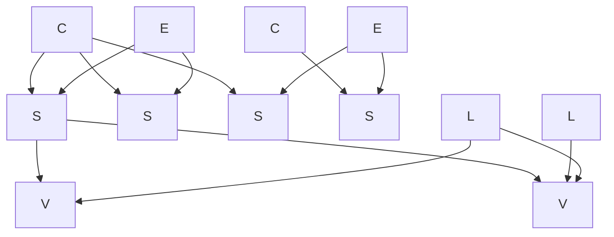
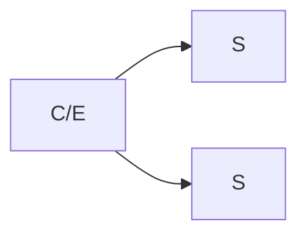
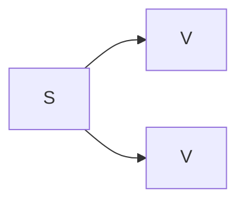
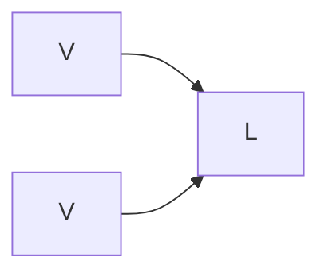

# Presentation

## Entities Graph

An essential aspect of the model devised for VEdition is that it reflects the **"constellation"** of texts which goes under the name of "Venetian epigrams", where there is no plain linear evolution.

Many versions of the "same" text (the abstraction we name "epigram", here `E`) coexist, scattered across multiple manuscripts or prints (the "text carriers", `C`), variously grouped under multiple collections (material or immaterial; `L`); and each of these documents (named "snapshots", `S`) mostly contains multiple "versions" of the text (`V`), as its manuscript annotations hint at various transformations of the text first jotted down on paper. So, these versions are not written at length, but they are the result of interpreting the annotations on the base text which hint at them. Such documents represent a "snapshot" of the creative process behind the transformations of a text, generating its multiple versions.

So, among these entities:

- `C` (carriers) contain `S` (snapshots);
- `E` (epigrams) contain `S` (snapshots);
- `S` (snapshots) contain (they actually generate) `V` (versions);
- `L` (collections) contain `V` (versions);
- `V` (versions) are the only entities representing text.

The result is a **graph** of nodes (=entities) which can be browsed starting from any node and following the links to any other node.

The diagram in Figure 1 exemplifies this graph:

- _Figure 1 - Top-level entities links_

In presenting these data we should try to reflect this complex set of relationships among different entities, allowing users to seamlessly hop from node to node and get a sense of their connection in the constellation.

If we consider the hierarchy intrinsic in the above defined entities, we can define 3 levels:

1. `C` and `E`
2. `S` and `L`
3. `V`

Here each upper level contains some or all entities of the lower level (Figures 2-4):

- _Figure 2: carriers and epigrams contain snapshots_

- _Figure 3: snapshots contain (generate) versions_

- _Figure 4: versions are grouped into collections_
