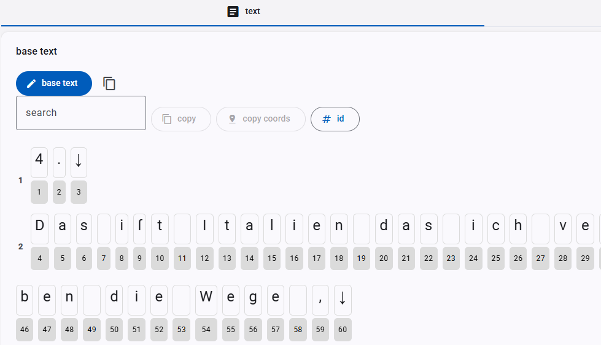
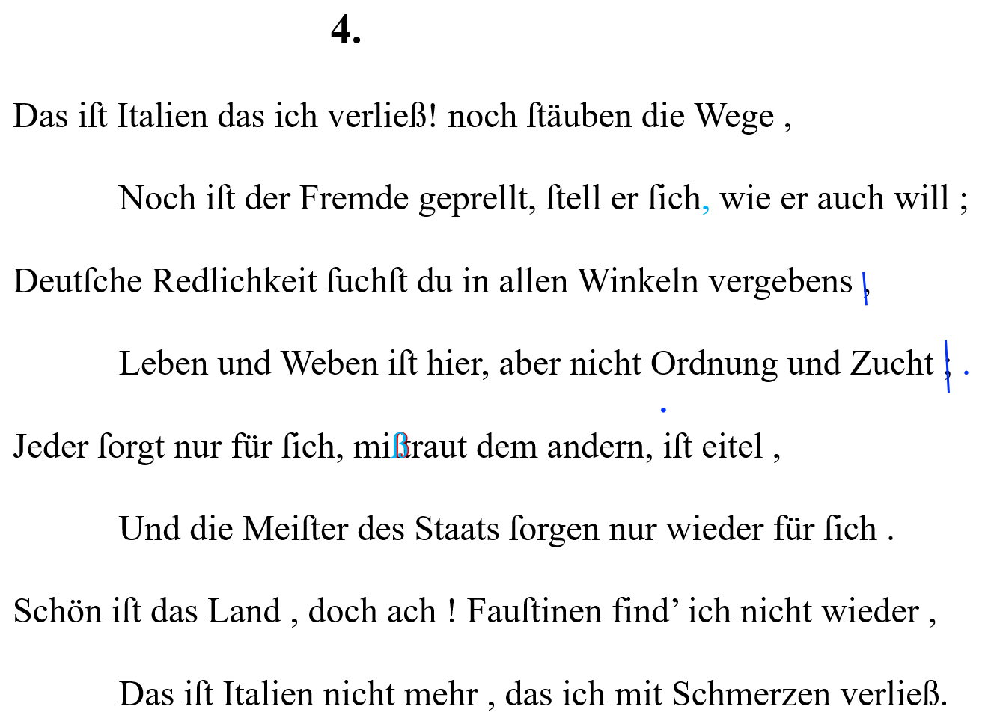
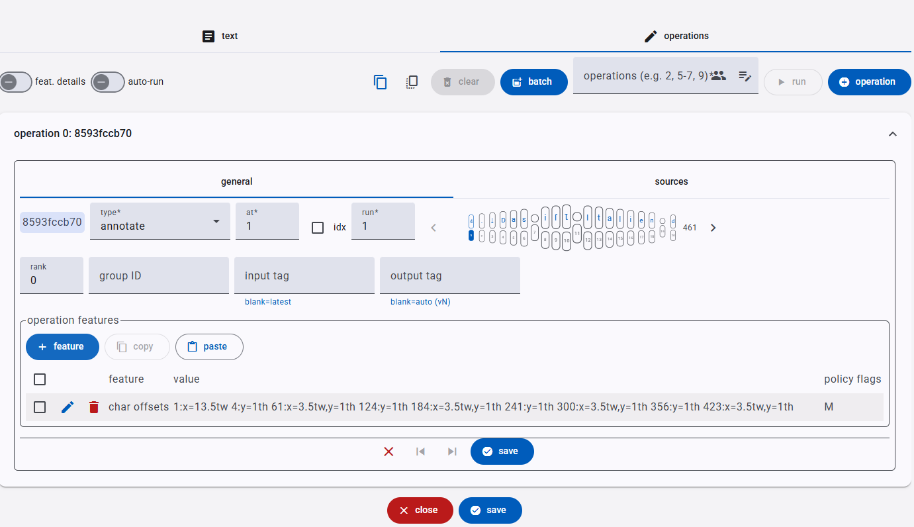
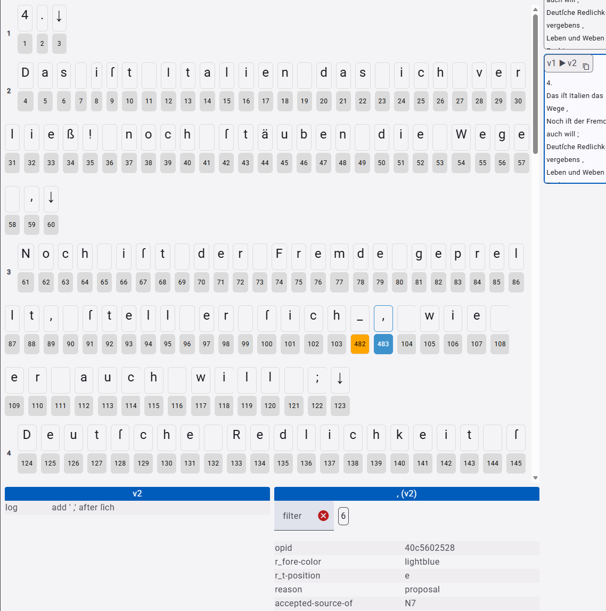
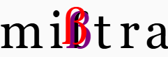
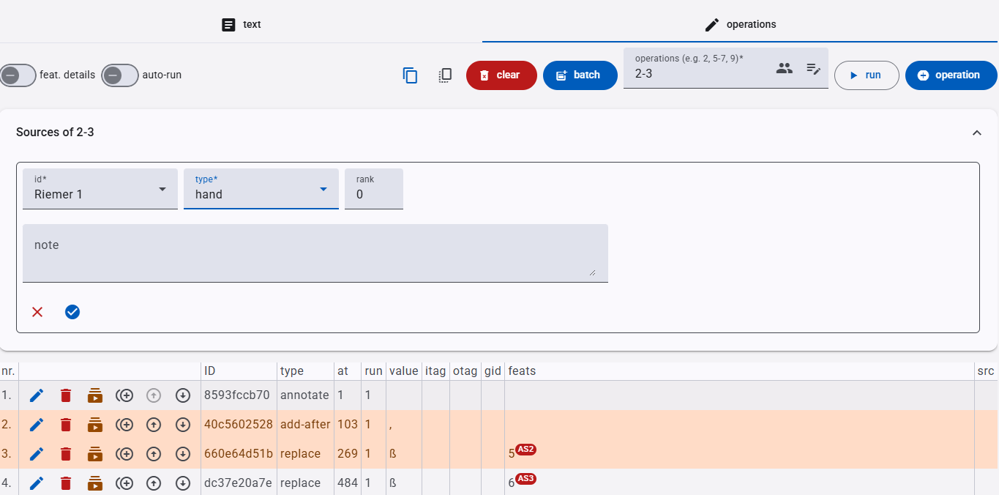
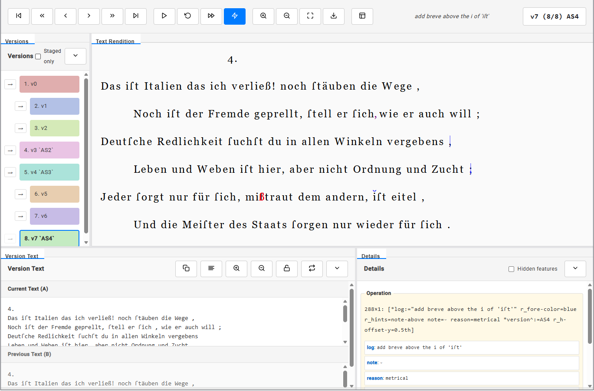

# Snapshot Sample 2

This is a guided, real-world example from VEdition (epigram 4 of notebook H5). In what follows:

- 👉 marks a hand.
- ▶️ marks an operation.
- ⚙️ marks technical explanatory notes.
- ✏️ marks a step in a guided procedure.
- 💡 marks a tip for learners.
- 🚩 marks an alteration stage end.
- ⚠️ marks a warning (=pay attention to avoid errors).

The base text is:

```txt
4.
Das iſt Italien das ich verließ! noch ſtäuben die Wege ,
Noch iſt der Fremde geprellt, ſtell er ſich wie er auch will ;
Deutſche Redlichkeit ſuchſt du in allen Winkeln vergebens ,
Leben und Weben iſt hier, aber nicht Ordnung und Zucht ;
Jeder ſorgt nur für ſich, miſtraut dem andern, iſt eitel ,
Und die Meiſter des Staats ſorgen nur wieder für ſich .
Schön iſt das Land , doch ach ! Fauſtinen find’ ich nicht wieder ,
Das iſt Italien nicht mehr , das ich mit Schmerzen verließ.
```

> Note that VEdition encodes also peculiar diplomatic aspects of the manuscript, like spaces before punctuation or `ſ` for `s`, without normalizations. An English translation can be found at <https://www.poetryintranslation.com/PITBR/German/GoetheVenetianEpigrams.php#anchor_Toc171440807>.

✏️ **Guided Work**

1. once you have entered the snapshot part editor, **click the "base text" button** and paste the text there.
2. **click "set" to set the new base text**, closing the dialog.
3. **click save** at the bottom whenever you want to commit your edits to the server. It is a good idea to save from time to time to avoid losing your work in case your computer has issues.

⚠️ The text will be displayed character by character. Each character gets a unique numeric ID, which for the base text is just its ordinal number (1=first, 2=second...). Anyway, this is just an opaque identifier with no intrinsic meaning. Newly added characters will get new IDs, thus breaking the illusion they are just ordinals.



---

## Description

This example is very simple because it comes from a 1799 print with a few handwritten annotations, mainly about punctuation. In this notebook we usually define 4 alteration stages:

1. self-corrections by Geist (ink), here absent. The stage is distinct only for alignment with other epigrams in the same source.
2. [Riemer](https://en.wikipedia.org/wiki/Friedrich_Wilhelm_Riemer) 1 (pencil).
3. Goethe 1 (red chalk).
4. Riemer 2 (pencil).

This word processor text summarizes the text appearance:



---

## Operations

### Indents

- 📐 the **first operation** only reflects the print layout, where each even line has been printed with an indent. This alteration is just a way to encode it as base text is plain text only. So, the operation only reflects the typesetter's work and does not belong to Riemer. Yet, to avoid redundant stages, conventionally we never assign a separate stage to indents, which, when present (as typical in print), always belong to the first operation in the snapshot.

As for any operation which does not alter the text, this is an _annotation_ operation. Such an operation type only carries features, i.e. metadata; in this case, the only feature needed is that encoding indents, named `r_char-offsets`. This is a [rendition feature](../model/rendition#rendition-features), i.e. a feature representing visual aspects. All such features have a name prefixed with `r_`.

- ▶️ (1) indent: add various horizontal offsets to specified characters and a constant vertical offset to all lines (to widen the space between lines as we want to reflect the actual print layout): the printed number, which is horizontally centered and thus has a larger offset; and each character starting an even line.

> Note that character offsets are multiple in this feature value. Each offset format is `ID:y=...,x=...` (where we can specify only `x`, only `y`, or both, in any order), where `ID`=target character ID, `y`=vertical offset to add to the computed character baseline (negative=up, positive=down), `x`=X offset to add to the computed character baseline (negative=left, positive=right).
>
> Both `x` and `y` can be followed by a unit specifier. The default unit is just pixels; otherwise, the value is followed by suffixes `tw`=text character average width (according to the current font and size) or `th`=text character average height.

⚙️ Our value for `r_char-offsets` here is:

```txt
1:x=13.5tw 4:y=1th 61:x=3.5tw,y=1th 124:y=1th 184:x=3.5tw,y=1th 241:y=1th 300:x=3.5tw,y=1th 356:y=1th 423:x=3.5tw,y=1th
```

💡 Usually we adopt text-width units (`tw`) for horizontal indents and text-height units (`th`) for vertical indents. These come in handy because they represent the average character width/height; so, empirically the user just has to count the amount of characters which in the line above an indented one are printed before the first character of the indented line to estimate a reasonable value. Then this can be adjusted by looking at the preview. This way we reproduce with a very good approximation the layout of printed documents, too.

✏️ **Guided Work**

1. **click the "operations" tab** to select it.
2. **click "add new operation"** at the top right (or press Alt+Shift+N). The operation editor opens.
3. in the editor, **pick the "annotate" type and enter coordinates**. The "at" and "run" coordinates represent the operation target: in this case, the text to annotate. "At" is the character numeric ID: each character has one: look at the small numbers below each character in base text. "Run" is the number of characters to target starting from "At". For indents, conventionally we only target the first character of the text (because indents are set once for the whole text): so here we just enter 1 for both "at" and "run". When you enter coordinates, a small context is displayed in the context "peeper" next to them.

   ⚙️ Note that when new characters are added to the text (by add/replace operations) they get new unique numeric IDs. So character IDs coincide with their positions only for base text; later, characters are inserted into it with their own numbers, thus breaking the progressive numeric sequence. This is not an issue, because the ID is an identifier and as such it has no intrinsic meaning. Yet it is worth noting, because users might assume that numbers refer to positions.

4. **add an operation feature for indents** using the "add feature button" (or pressing Alt+Shift+F). The operation feature editor opens.
5. **pick the char offsets feature** in name. You can scroll the list of features or type some characters to filter it (usually this is quicker).
6. **paste the offsets in value** (see above).
7. **save the feature** clicking the "save" button. It appears in the features box.
8. **save the operation** clicking the "save" button. It appears in the operations list. Also, at the bottom _the rendition will show all indents_. 💡 To _show a quick overview of operation features_, toggle the "feat. details" switch at the top-left corner and look at the "feats" column in the operations list.



### Riemer 1

- 👉 **Riemer 1** (light blue):

- ▶️ (2) add comma after `ſich`. Given that the convention is having a space before punctuation, we also add a space before the added comma.

✏️ **Guided Work**

1. **add a new operation**; the operation editor opens. Set type="add-after", "at"=`103`, "run"=`1`, value=` ,` (space + comma).
2. **add operation features**:
   - log = `add ' ,' after ſich`. 💡 It is a good practice to always add log to operations (except for the first indents operation) describing them in a few words. This will help viewers focus on the changing part when viewing the rendition.
   - foreground color = purple. ⚠️ For this exercise we replace light blue with a darker, more visible color.
   - position = east. This tells where the text was added: here to the right of the word. In manuscripts positions are essential because text is added by hand wherever there is room for it, usually above the line. 💡 Position is always _relative_ to the target text; and this conceptually makes sense, because annotations owe their existence to it. Imagine a rectangle around the text targeted by the operation coordinates: the relative position is defined with cardinal points, so north=above, south=below, east=right, etc. The default relative position is origin, which means the center of the imaginary rectangle, and is used to overwrite or to wrap text in shapes.
   - reason = proposal. This is an editorial evaluation for that annotation.
   - accepted source of = `N7`.

3. **save operation**. Remember to save also the whole snapshot to the server from time to time.

Look below the operations list: you will see the text output by each of them. On the right there is a map with all the outputs from operations, in their order. When you click any of them you see the text on the left. Except for annotation operations, the output text will be different from the previous one. Additionally, operations inject metadata, which when referred to the whole text (rather than just to the target one) are displayed below. You will see the log feature there.

Look at the last output in map, "v1 > v2". The orange characters are those affected by the operation: in this case the added space and comma. Click on one of them to see further metadata injected into those characters only. So, _operations not only generate new text: they also annotate it_.



- ▶️ (3) replace `ſ` with `ß`. Note that this change is the source for another document, N7.

✏️ **Guided Work**

1. **add a new operation**; the operation editor opens. Set type="replace", "at"=`269`, "run"=`1`, value=`ß`.
2. **add operation features**:
   - log = `replace 'ſ' with 'ß' in miſtraut`.
   - reason=proposal.
   - accepted source of = `N7`.
   - foreground color = purple.
   - 🚩 stage name = `AS2`: this feature _marks the end of this alterations stage_. All the operations executed up to this point accumulated changes on the same text. At this point, we consider this a true waypoint along the creative path of this text, mainly because of the hand change in the next operation. Thus the output of this operation will be considered a self-contained alteration stage.

   > Note that there is no position. The default position is `origin`: so `ß` will be overwritten to `ſ` in our rendition; just what we want.

3. **save operation**.

🚀 You can now **look at the rendition** at the bottom to see what you encoded until now. You can do this at any moment: just run all the operations (the "run" button is at the top-right) and then in the rendition toolbar click the "start slideshow" button to see all operations unwind over time, according to the visuals you encoded for each of them. At the right of the rendition toolbar you will see the log value of each operation.

Hovering the mouse on text shows at the bottom details about all metadata injected by operations, both into the text as a whole and into specific portions of it. At the left you see all the alterations and those which are staged; at the bottom you can see the text of each output and the diffing between any two of them. Feel free to explore here, the rendition has a lot of functions because it is intended also for use in the final publication.

### Goethe

- 👉 **Goethe** (red):

- ▶️ (4) Goethe literally rewrites `ß` over the `ß` written by Riemer to confirm the change. So, again this is a replacement operation, where the new value is equal to the old one. 💡 This means that in the end the resulting text does not change; but we encode it because _we are reconstructing a process_, not just a text. The text is a byproduct of the process. In this process, we must encode the action of Goethe who confirmed the change by his secretary. Goethe re-wrote the letter; and we are encoding right that. Additionally, that process left traces on paper, as the letter was overwritten, by a different hand and with a different color. In the highly diplomatic context of VEdition we want to preserve visual information, too. This will allow us to reproduce it in text rendition when displaying it.

✏️ **Guided Work**

1. **add a new operation**; the operation editor opens. Set type="replace", "at"=`484`, "run"=`1`, value=`ß`.
2. **add operation features**:
   - log = `replace 'ß' with 'ß' in miſtraut`.
   - foreground color = red.
   - reason = confirmation.
   - accepted source of = `N7`.
   - 🚩 stage name = `AS3`.
   - X offset and Y offset = `-2`. This is a refinement to let the previous letters still be partially visible behind the new one, like it happens on paper. By slightly offsetting the position of the newly written read `ß`, we avoid to completely hide the purple `ß` behind it:
3. **save operation**. You can re-run operations and see the updated rendition at will.

Here is the rendition result with the offsets in place:



### Riemer 2

- 👉 **Riemer 2** (blue):

- ▶️ (5) delete `,` after `vergebens` with a vertical stroke on it. Note that this proposal was rejected in later documents N7 and A1.

✏️ **Guided Work**

1. **add a new operation**; the operation editor opens. Set type="delete", "at"=`181`, "run"=`2`. Value is empty: being a deletion, no new text is to be defined. Note that as usual punctuation is preceded by space, so here we delete space + comma, not just comma; otherwise we would end up with an extra trailing space.
2. **add operation features**:
   - log = `delete ',' after 'vergebens'`.
   - foreground color = blue.
   - hints = `vertical-stroke`. This deletion is visually represented in the text by a vertical stroke on the comma. That's the visual counterpart of the operation in our document. ⚠️ Once you select the `vertical-stroke` hint from the list of values, click the `+` button next to it. This is because an operation can have multiple hints, so you might want to select several hints and repeatedly add them in the feature value, separated by spaces.
   - displaced hint span = `182x1`. This feature allows to "displace" the hint using as reference text for its position a different span, here `182x1`. Without this feature, the hint would be placed relative to the targeted text, i.e. `181x2` (space + comma) and would thus approximately appear between these two characters (=to the left of the comma); instead, we want it relative to the comma only so that it overwrites it (whence 182 by 1 character).
   - hint X scale = `6`. As a general rule, 💡 _the hint sign not only is positioned relative to the reference text; it is also sized as its imaginary bounding rectangle_. So, in case of extremely narrow characters like a comma, a vertical line would be sized so thin that it would become invisible. To compensate for this, we add a 600% horizontal scale to the hint (here the line). This way it becomes visible and sized as in the document.
   - reason = proposal.
   - rejected source of = `N7 A1`.
3. **save operation**. If you want to see the rendition, just run and replay it. 💡 To compress the animation times you can remove intervals between each operation by toggling the bolt button in the rendition toolbar. This is handy during editing when you often want to look at the result visually.

- ▶️ (6) replace `;` with `.` after `Zucht`. Again, this proposal was rejected in N7 and A1.

✏️ **Guided Work**

1. **add a new operation**; the operation editor opens. Set type="delete", "at"=`239`, "run"=`1`, value=`.`. Note that as usual punctuation is preceded by space, so here we delete space + comma, not just comma; otherwise we would end up with an extra trailing space.
2. **add operation features**:
   - log = `replace ';' with '.' after 'Zucht'`.
   - foreground color = blue.
   - hints = `vertical-stroke`.
   - hint X scale = `6`.
   - reason = proposal.
   - rejected source of = `N7 A1`.

- ▶️ (7) add `˘` (a _breve_ sign) above the `i` of `iſt` to mean that metrically this is a weak position.

1. **add a new operation**; the operation editor opens. Set type="annotate", "at"=`288`, "run"=`1`. Note that as usual punctuation is preceded by space, so here we delete space + comma, not just comma; otherwise we would end up with an extra trailing space.
2. **add operation features**:
   - log = `add breve above the i of 'iſt'`.
   - foreground color = blue.
   - hints = `note-above`.
   - note = `⏑`.
   - hint Y offset = `0.5th`.
   - reason = `metrical`.
   - stage name = `AS4`.

### Adding Hands

Among operation metadata there is also the source of the operation, which in our case is the hand which traced its visual part on the sheet. The operation editor has a source tab for that; but given that usually many operations belong to the same hand in a sequence, we prefer to annotate this once for all of them instead that one at a time.

So here we need to assign operations to hands as follows:

- 2-3 = Riemer 1
- 4 = Goethe
- 5-6 = Riemer 2

✏️ **Guided Work**

1. in the operations toolbar above their list, click in the "operations" textbox (next to the "batch" button) and type `2-3`. This means we are going to edit all the operations in this range. Then click the people icon to open the batch sources editor. A new editor opens below.
2. in "ID" pick `Riemer 1`: this is the hand identifier.
3. in "type" pick `hand`: this is the source type. Here we have only 1 type, hand; but other projects might have different source types (e.g. other documents). 💡 Note that the whole Hydra model is totally agnostic with reference to almost all values you see in lists in the UI. These are defined in external taxonomies, which define the profile for each project. So _here you are just working with the set of taxonomies designed for VEdition; but Hydra is a generic model and tool_ designed to fit any other project.

   > The rank value can be used to define the level of certainty for this source attribution; while a generic note can be put in note. Here we just need to set the hand ID.

4. **click the save button**. The sources editor close. Now operations 2 and 3 got this source at once (mind the sources count at the right edge of the operations list).

   

5. **repeat the procedure 1-4 for the other ranges**: 4=Goethe (or if you prefer just edit the operation), 5-6=Riemer 2.

Finally, run all operations and look at the rendition:



---

## DSL

All data we entered via the UI can be encoded as plain text:

- base text:

```txt
4.
Das iſt Italien das ich verließ! noch ſtäuben die Wege ,
Noch iſt der Fremde geprellt, ſtell er ſich wie er auch will ;
Deutſche Redlichkeit ſuchſt du in allen Winkeln vergebens ,
Leben und Weben iſt hier, aber nicht Ordnung und Zucht ;
Jeder ſorgt nur für ſich, miſtraut dem andern, iſt eitel ,
Und die Meiſter des Staats ſorgen nur wieder für ſich .
Schön iſt das Land , doch ach ! Fauſtinen find’ ich nicht wieder ,
Das iſt Italien nicht mehr , das ich mit Schmerzen verließ.
```

- operations:

```txt
1×1: [r_char-offsets="1:x=13.5tw 4:y=1th 61:x=3.5tw,y=1th 124:y=1th 184:x=3.5tw,y=1th 241:y=1th 300:x=3.5tw,y=1th 356:y=1th 423:x=3.5tw,y=1th"]
103×1+]" ," [r_fore-color=purple r_t-position=e reason=proposal accepted-source-of=N7 *log:="add ' ,' after ſich"]
269×1="ß" [*log:="replace 'ſ' with 'ß' in miſtraut" r_fore-color=purple reason=proposal accepted-source-of=N7 *version^:=AS2]
484×1="ß" [*log:="replace 'ß' with 'ß' in miſtraut" r_fore-color=red r_t-position=inw reason=confirmation accepted-source-of=N7 *version^:=AS3]
181×2- [*log:="delete ',' after 'vergebens'" r_fore-color=blue r_hints=vertical-stroke reason=proposal rejected-source-of="N7 A1" r_h-displaced-span=182x1 r_h-scale-x=6]
239×1="." [*log:="replace ';' with '.' after 'Zucht'" r_fore-color=blue r_hints=vertical-stroke r_h-scale-x=6 reason=proposal rejected-source-of="N7 A1"]
288×1: [*log:="add breve above the i of 'iſt'" r_fore-color=blue r_hints=note-above note=⏑ reason=metrical *version^:=AS4 r_h-offset-y=0.5th]
```
